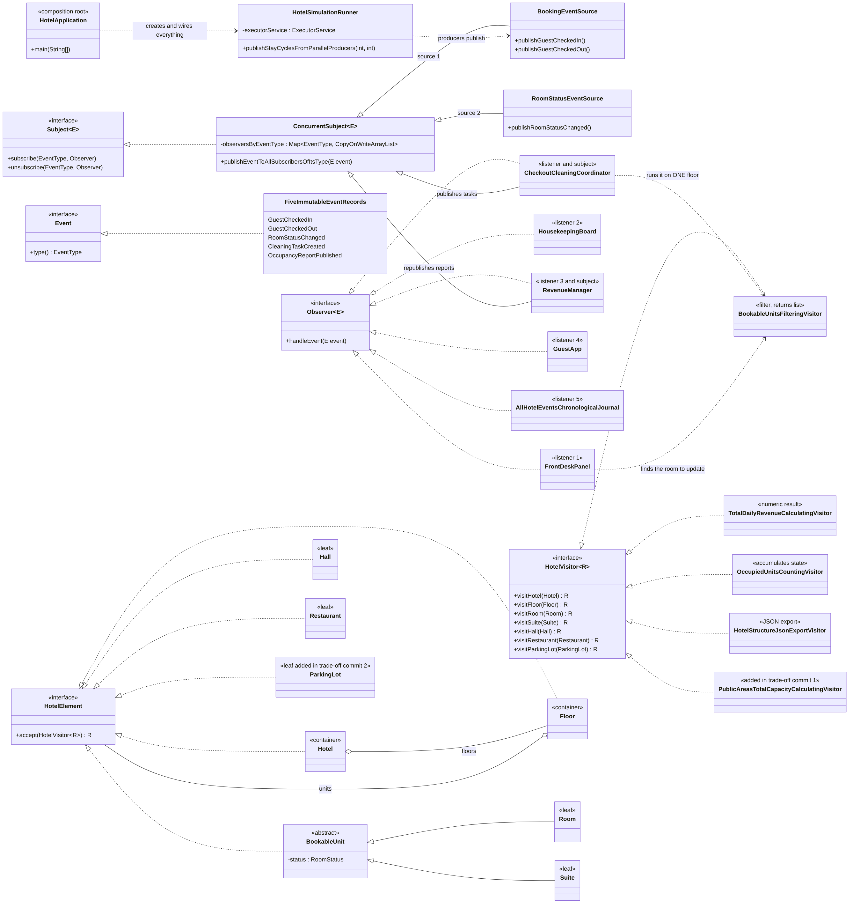

# Hotel Management: Observer + Visitor (Assignment 6, variant 20)

A small Java 17 system for a hotel. Two sources send events (bookings and room status changes) to five listeners.
The hotel itself is a stable tree (Hotel -> Floor -> rooms, suites, halls, restaurants) that is processed by visitors.
When a guest checks out, an event starts a visitor on **one floor only**, and the result comes back as new events.

No libraries except JUnit 5. No `java.util.Observable`, no event-bus library.

## How to open and run

1. IntelliJ IDEA: **File -> Open** -> choose the `pom.xml` -> **Open as Project**. Use JDK 17 or newer.
2. Run the demo: open `src/main/java/hotel/HotelApplication.java` and press the green arrow next to `main`.
   Optional program arguments: `producerThreadCount stayCyclesPerProducer` (default `4 250`).
3. Run the tests: right-click `src/test/java` -> **Run 'All Tests'**, or in a terminal: `mvn test`.

## Package map

| Package | What is inside |
|---|---|
| `hotel.observer` | `Event`, `EventType`, `Observer<E>`, `Subject<E>`, `ConcurrentSubject<E>` (the thread-safe registry) |
| `hotel.events` | Five immutable event records |
| `hotel.sources` | The two subjects: `BookingEventSource`, `RoomStatusEventSource` |
| `hotel.listeners` | Five listeners |
| `hotel.tree` | The Composite tree, `HotelElement`, `HotelVisitor<R>` |
| `hotel.visitors` | The visitors |
| `hotel.integration` | `CheckoutCleaningCoordinator`, the link between the two patterns |
| `hotel.simulation` | `HotelSimulationRunner`: producer threads on an `ExecutorService` |
| `hotel` | `HotelApplication` (the composition root) and `GrandHotelFactory` (sample data) |

## 1. Observer

**Sources (subjects):** `BookingEventSource` (check-in, check-out) and `RoomStatusEventSource` (room status changed).

**Listeners:**

| Listener | Listens to | What it does |
|---|---|---|
| `FrontDeskPanel` | check-in, check-out, status changed | remembers who sleeps where and updates room statuses in the tree |
| `HousekeepingBoard` | cleaning task | keeps the set of rooms waiting for the cleaners |
| `RevenueManager` | check-in, check-out | counts staying guests and **republishes** the number (listener and subject) |
| `GuestApp` | check-in, check-out | sends a welcome and a goodbye message |
| `AllHotelEventsChronologicalJournal` | every type, from every source | writes down every event in arrival order |

**Chain of observers:** `booking source -> RevenueManager -> OccupancyReportPublished -> journal`.
`CheckoutCleaningCoordinator` is also both a listener and a subject, so there is a second chain.

**Events** are Java `record`s: immutable by definition, each one returns its `EventType`.
Listeners subscribe per type: `subject.subscribe(EventType.GUEST_CHECKED_IN, observer)`.

**Push, not pull.** The event carries all the data a listener needs (guest, room, floor, new status).
Reasons: (1) a listener never has to call back into the source, so there is no shared mutable state to read
while other threads are publishing; (2) the event is a true snapshot of what happened, even if the state changes a moment later;
(3) listeners are simpler, they only read the event.

**Join and leave at runtime.** `subscribe` and `unsubscribe` can be called at any time from any thread,
also from inside a handler (tests: `observerCanUnsubscribeItselfInsideItsOwnHandler`,
`observerSubscribedInsideAHandlerOnlySeesLaterEvents`).

**What happens if a listener unsubscribes while several threads are publishing?**
The registry is a map `EventType -> CopyOnWriteArrayList<Observer>`.
The map is filled once in the constructor and never changes, so reading it needs no lock.
`CopyOnWriteArrayList` makes a new copy of its array on every add/remove, and a `for` loop walks over the old, unchanged snapshot.
So a publisher never sees a half-changed list and never throws `ConcurrentModificationException`.
Consequence: an observer that unsubscribes may still receive the event that is being delivered at that moment (it is in the snapshot),
and a new observer receives only later events. There is no lock on the subject (test: `observersCanJoinAndLeaveWhileFourThreadsArePublishing`).
Observers are called in the order in which they subscribed.

## 2. Visitor

**Tree:** `Hotel` (container) -> `Floor` (container) -> leaves: `Room`, `Suite`, `Hall`, `Restaurant`. That is 3 levels, 2 container types, 4 leaf types.
`Room` and `Suite` share the abstract class `BookableUnit` (number, nightly rate, status) so that this data is not written twice.
The elements hold data only. The only behavior is `accept`, which calls `visitor.visitXxx(this)`.

**Visitors** (all implement `HotelVisitor<R>`):

| Visitor | R | Kind |
|---|---|---|
| `TotalDailyRevenueCalculatingVisitor` | `Integer` | numeric calculation |
| `OccupiedUnitsCountingVisitor` | `OccupancyStatistics` | accumulates state across the whole tree (two counters) |
| `BookableUnitsFilteringVisitor` | `List<BookableUnit>` | filter with a condition, returns a list |
| `HotelStructureJsonExportVisitor` | `String` | hand-written JSON, nesting built from the children's results |

A visitor that keeps counters or a list is used for **one** walk only, so create a new one every time.

**Who does the traversal? The visitor.** The element only says "visit me" and does not know how to walk the tree.
Reasons: (1) the JSON export must write text *before and after* the children (`[` ... `]`), which only the visitor can do;
(2) different visitors combine the results of children differently (sum, list, text), so the traversal belongs to the operation;
(3) starting on a subtree is trivial: `floor.accept(visitor)` visits that floor and nothing else.
To avoid copying the loop into every visitor, `HotelVisitor` has one helper `visitEachChildAndCollectResults`.

**Double dispatch for one element, a `Suite`:**
1. The client holds a `HotelElement` and a `HotelVisitor` and calls `element.accept(visitor)`. Java picks `Suite.accept` because of the real class of the element (first dispatch).
2. Inside, `Suite.accept` calls `visitor.visitSuite(this)`. Here `this` is known to be a `Suite`, so the compiler picks the overload `visitSuite(Suite)` (second dispatch), and the real visitor class decides what to do.
3. Why not simply `visitor.visit(node)` in the client? Java chooses overloads by the *declared* type at compile time. With a `HotelElement` variable it would not know whether the node is a room or a hall.
Test: `DoubleDispatchTest`.

## 3. Integration: Observer event -> visitor on a subtree -> new events

```
GuestCheckedOut ──> FrontDeskPanel: room becomes NEEDS_CLEANING
                └─> CheckoutCleaningCoordinator: finds the floor by name
                        └─> BookableUnitsFilteringVisitor on THAT floor only (status == NEEDS_CLEANING)
                              └─> publishes one CleaningTaskCreated per room found ──> HousekeepingBoard, journal
```

A dirty room on another floor is **not** reported (test: `checkoutOnFirstFloorCreatesTaskOnlyForFirstFloorEvenThoughSecondFloorHasDirtyRooms`).

## 4. Concurrency

* `HotelSimulationRunner` submits one producer per thread to an `ExecutorService`. The thread count is a parameter (`HotelApplication` arguments), default 4.
  Each producer plays "stay cycles" in its own room: check-in, check-out, status VACANT (3 events per cycle).
* **Thread-safe state:** the registry (see above); room status is `volatile`; `FrontDeskPanel` uses `ConcurrentHashMap`;
  `HousekeepingBoard` a concurrent set; `RevenueManager` an `AtomicInteger`; the journal and the guest app a `ConcurrentLinkedQueue`.
  Delivery is synchronous: the thread that publishes runs the handlers, so nothing is queued and nothing can be lost in a buffer.
* **Graceful shutdown:** the runner waits for every producer with `Future.get()` (an error in a producer is rethrown, not hidden),
  then calls `shutdown()` and `awaitTermination()`. No event is lost and no thread keeps running (test: `executorThreadsAreStoppedWhenTheRunIsFinished`).
* **Subscription order matters** and is documented in `HotelApplication.connectListenersToSources`: the journal subscribes first
  (a cause is recorded before its effects), and the front desk subscribes before the coordinator
  (the room is already `NEEDS_CLEANING` when the coordinator looks for dirty rooms).

## 5. Clean Code decisions

* **One composition root:** only `HotelApplication` creates objects and connects them. Everything else gets its dependencies through the constructor.
* **No lazy initialization** in business code; all fields are filled in constructors or field initializers.
* **Names say what the code does** (`publishEventToAllSubscribersOfItsType`, `removeGuestAndMarkRoomNeedsCleaning`). Methods are short, one action each.
* **No duplication:** one filter visitor is used for "needs cleaning", "find room by number" and "list all rooms";
  `BookableUnit` holds the shared room data; one `HotelVisitor` helper walks the children.
* **Each class has a reason:** `RoomOnFloor` (a producer needs a room and its floor name), `OccupancyStatistics` (result of a visitor), `GrandHotelFactory` (sample data).
* **Known limit:** if a listener throws an exception, it goes up to the publisher. This is kept simple on purpose.

## 6. Trade-off proof (two separate commits)

The base project has four visitors and four leaf types. Two later commits show the cost of each kind of change.

### Commit 1: a new visitor (`Add PublicAreasTotalCapacityCalculatingVisitor`)

| Change | File |
|---|---|
| new | `src/main/java/hotel/visitors/PublicAreasTotalCapacityCalculatingVisitor.java` |
| new | `src/test/java/hotel/visitors/PublicAreasTotalCapacityCalculatingVisitorTest.java` |

**Existing files changed: 0. Element classes changed: 0.** The cost is one new class and its test.
This is where Visitor is strong: new operations are added without touching the tree.

### Commit 2: a new element type (`Add ParkingLot element type`)

| Change | File |
|---|---|
| new | `src/main/java/hotel/tree/ParkingLot.java` |
| new | `src/test/java/hotel/visitors/ParkingLotInEveryVisitorTest.java` |
| changed | `src/main/java/hotel/tree/HotelVisitor.java` (new method `visitParkingLot`) |
| changed | `src/main/java/hotel/visitors/TotalDailyRevenueCalculatingVisitor.java` |
| changed | `src/main/java/hotel/visitors/OccupiedUnitsCountingVisitor.java` |
| changed | `src/main/java/hotel/visitors/BookableUnitsFilteringVisitor.java` |
| changed | `src/main/java/hotel/visitors/HotelStructureJsonExportVisitor.java` |
| changed | `src/main/java/hotel/visitors/PublicAreasTotalCapacityCalculatingVisitor.java` |
| changed | `src/test/java/hotel/tree/DoubleDispatchTest.java` (its test visitor implements the interface) |

**7 existing files changed for one new element:** the interface, all 5 visitors, and 1 test visitor.
The old element classes (`Room`, `Suite`, `Hall`, `Restaurant`, `Hotel`, `Floor`) did not change.
The compiler lists every visitor that must be updated, so nothing is forgotten, but the work grows with the number of visitors:
with 5 visitors it is 5 edits, with 20 visitors it would be 20.

### When would I reject Visitor?

When the **element types change often and the operations are few**. Then every new element touches every visitor,
and it is cheaper to put the operation as a method into each element class. In this hotel the element types are stable
(a hotel rarely gets a new kind of space) while new reports are asked for often, so Visitor is the right choice here.

## 7. Tests

41 tests after both trade-off commits (35 in the base project). JUnit 5 only.

| Test class | What it proves |
|---|---|
| `ConcurrentSubjectTest` | per-type delivery, unsubscribe, order, unsubscribe and subscribe inside a handler, **stress test 4 threads x 1000 events = exactly 4000**, join/leave while publishing |
| `HotelEventsTest` | event types, value equality |
| `DoubleDispatchTest` | every element calls its own visit method |
| `TotalDailyRevenueCalculatingVisitorTest` | revenue against hand-calculated values |
| `OccupiedUnitsCountingVisitorTest` | counters against hand-calculated values |
| `BookableUnitsFilteringVisitorTest` | filter on the whole hotel and on one floor |
| `HotelStructureJsonExportVisitorTest` | exact JSON text, escaping, balanced brackets |
| `HotelListenersTest` | each listener, the chain through `RevenueManager`, the second source |
| `CheckoutCleaningCoordinatorTest` | the visitor runs on one floor only, unknown floor, order of events |
| `HotelSimulationRunnerTest` | 3 and 4 producers lose no events, executor is stopped, hotel without rooms is rejected |

**Hand-calculated test hotel** (`KnownHotelFactory`):

| Floor | Units |
|---|---|
| Floor 1 | Room 101 (rate 100, occupied), Room 102 (rate 120, vacant), Restaurant (revenue 700) |
| Floor 2 | Suite 201 (rate 300, occupied), Suite 202 (rate 350, needs cleaning), Room 203 (rate 110, needs cleaning), Hall (rental 1000) |

Revenue: floor 1 = 100 + 700 = **800**, floor 2 = 300 + 1000 = **1300**, hotel = **2100**.
Occupied rooms and suites: **2 of 5** (floor 1: 1 of 2, floor 2: 1 of 3). Needs cleaning: rooms **202, 203**. Public capacity (commit 1): 200 + 40 = **240**.

## 8. UML class diagram

Source: [`docs/uml-class-diagram.mmd`](docs/uml-class-diagram.mmd). Image: [`docs/uml-class-diagram.png`](docs/uml-class-diagram.png).
`ParkingLot` and `PublicAreasTotalCapacityCalculatingVisitor` appear in the diagram because they are added by the two trade-off commits.


